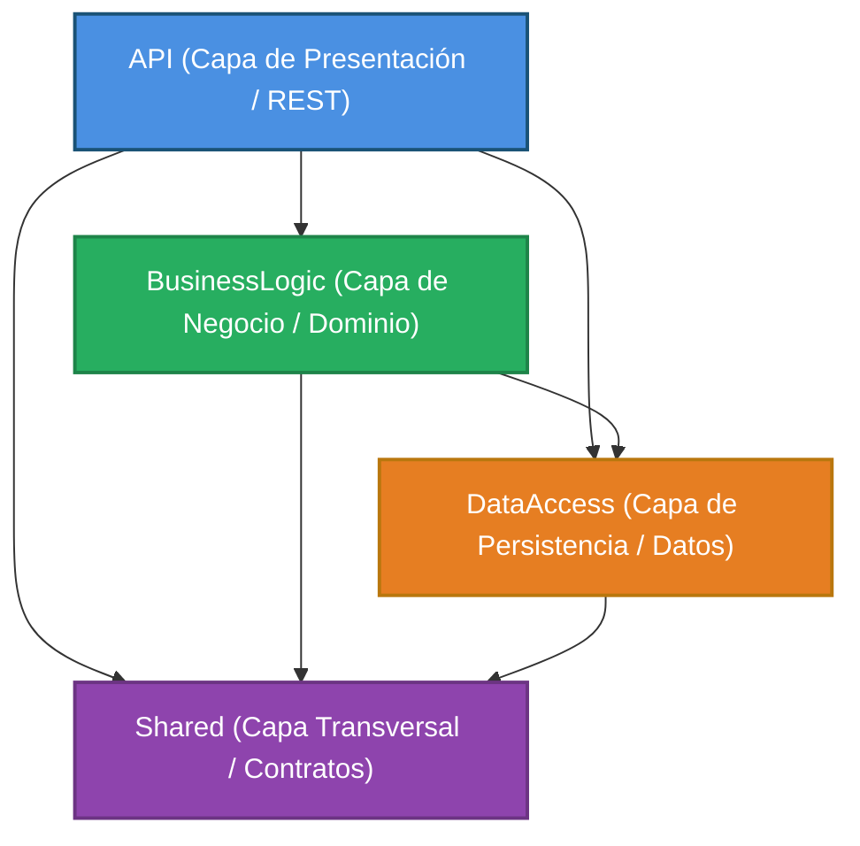
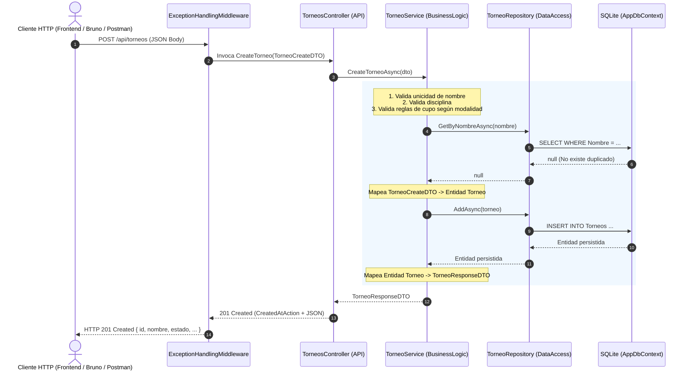
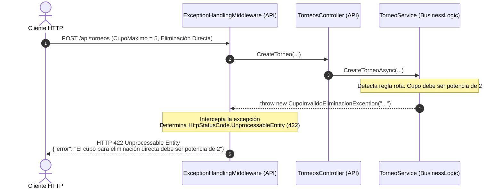
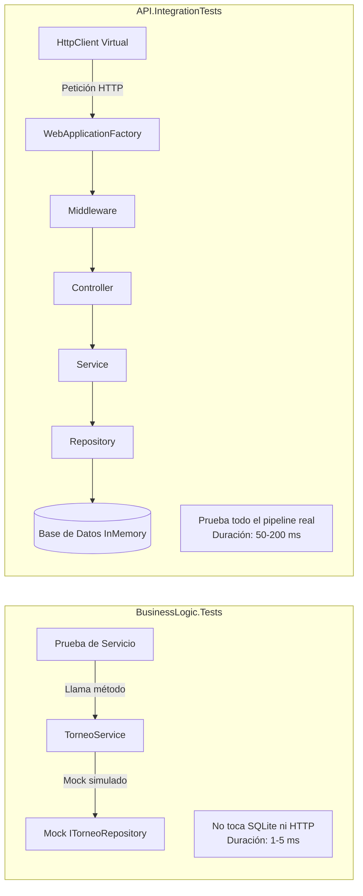

# Arquitectura en N-Capas y Flujo de Comunicación
## Plataforma de Gestión de Torneos Deportivos (.NET 10)

Este documento describe en profundidad la arquitectura en **N-Capas (N-Tier)** de la solución, explicando la responsabilidad de cada capa, cómo se comunican entre sí mediante **Inyección de Dependencias (DI)** y el ciclo de vida completo de las peticiones HTTP tanto en flujos exitosos como ante errores de negocio.

---

## 1. ¿Qué es una Arquitectura en N-Capas?

La arquitectura en N-Capas organiza el sistema en niveles lógicos jerárquicos y especializados, donde cada capa tiene una **única responsabilidad bien delimitada** (Principio de Responsabilidad Única - SRP).

### Beneficios Clave
- **Desacoplamiento:** Los cambios en cómo se almacenan los datos (SQLite, SQL Server, etc.) no afectan a las reglas de negocio ni a los controladores de la API.
- **Testeabilidad:** Permite probar las reglas de negocio de manera aislada (pruebas unitarias con mocks) sin necesidad de levantar una base de datos real ni un servidor web.
- **Mantenibilidad:** Si surge un requerimiento nuevo o una regla cambia (por ejemplo, el cupo mínimo de un torneo), el desarrollador sabe exactamente en qué capa y archivo intervenir.

---

## 2. Mapa de las 4 Capas de la Solución

El proyecto está dividido en cuatro proyectos .NET principales:



### Tabla Comparativa de Responsabilidades

| Capa | Rol Principal | ¿Qué CONTIENE? | ¿Qué TIENE PROHIBIDO? |
| :--- | :--- | :--- | :--- |
| **`API`** | Exposición HTTP / REST | Controladores (`Controllers`), Middlewares globales, configuración de arranque (`Program.cs`). | No debe contener lógica de negocio, cálculos de puntos, ni consultas directas a la base de datos (DbContext/SQL). |
| **`BusinessLogic`** | Núcleo del Sistema / Reglas | Servicios (`TorneoService`, etc.), validaciones complejas, orquestación, cálculo de fixture/posiciones, mapeos DTO ↔ Entidad. | No debe conocer HTTP (`HttpContext`, `IActionResult`, códigos de estado 200/404), ni crear instancias directas de `AppDbContext`. |
| **`DataAccess`** | Persistencia de Datos | Contexto de EF Core (`AppDbContext`), Entidades (`Torneo`, `Equipo`, `Jugador`), Repositorios (`GenericRepository`, etc.), Migraciones. | No debe aplicar reglas de negocio ni conocer los DTOs que ve el cliente exterior. |
| **`Shared`** | Contratos Comunes | DTOs (Data Transfer Objects), Enumeraciones (`Disciplina`, `Modalidad`), Excepciones de dominio tipadas. | No debe depender de ningún otro proyecto de la solución (cero dependencias internas). |

---

## 3. Detalle de Cada Capa

### 3.1. Capa `Shared` (Capa Transversal)
Es la base contractual sobre la que se comunican todas las capas.
- **DTOs (`Shared/DTOs`):** Modelan la forma en que los datos viajan hacia la API y desde la API. Por ejemplo, [TorneoCreateDTO](file:///e:/2do%20a%C3%B1o%20Desarrollo%20de%20software/Practica%20Profesionalizante%20I/Grupo-N-11-PlataformaDeTorneosDeportivos/Shared/DTOs/TorneoDTOs.cs) para la entrada y [TorneoResponseDTO](file:///e:/2do%20a%C3%B1o%20Desarrollo%20de%20software/Practica%20Profesionalizante%20I/Grupo-N-11-PlataformaDeTorneosDeportivos/Shared/DTOs/TorneoDTOs.cs) para la salida. Cuentan con validaciones declarativas mediante `DataAnnotations` (`[Required]`, `[StringLength]`).
- **Enums (`Shared/Enums`):** Estados y tipos fuertemente tipados ([Enums.cs](file:///e:/2do%20a%C3%B1o%20Desarrollo%20de%20software/Practica%20Profesionalizante%20I/Grupo-N-11-PlataformaDeTorneosDeportivos/Shared/Enums/Enums.cs)), como `Modalidad` (Liga, EliminacionDirecta), `EstadoTorneo`, `EstadoInscripcion`, etc.
- **Excepciones de Dominio (`Shared/Exceptions`):** Excepciones semánticas como [NotFoundException](file:///e:/2do%20a%C3%B1o%20Desarrollo%20de%20software/Practica%20Profesionalizante%20I/Grupo-N-11-PlataformaDeTorneosDeportivos/Shared/Exceptions/NotFoundException.cs), [CupoInvalidoEliminacionException](file:///e:/2do%20a%C3%B1o%20Desarrollo%20de%20software/Practica%20Profesionalizante%20I/Grupo-N-11-PlataformaDeTorneosDeportivos/Shared/Exceptions/CupoInvalidoEliminacionException.cs), [BusinessRuleConflictException](file:///e:/2do%20a%C3%B1o%20Desarrollo%20de%20software/Practica%20Profesionalizante%20I/Grupo-N-11-PlataformaDeTorneosDeportivos/Shared/Exceptions/BusinessRuleConflictException.cs).

### 3.2. Capa `DataAccess` (Acceso a Datos)
Se encarga exclusivamente de hablar con la base de datos (SQLite en este proyecto mediante Entity Framework Core 10).
- **Entidades (`DataAccess/Entities`):** Clases C# que representan tablas en la base de datos, por ejemplo [Torneo](file:///e:/2do%20a%C3%B1o%20Desarrollo%20de%20software/Practica%20Profesionalizante%20I/Grupo-N-11-PlataformaDeTorneosDeportivos/DataAccess/Entities/Torneo.cs), [Equipo](file:///e:/2do%20a%C3%B1o%20Desarrollo%20de%20software/Practica%20Profesionalizante%20I/Grupo-N-11-PlataformaDeTorneosDeportivos/DataAccess/Entities/Equipo.cs), [Jugador](file:///e:/2do%20a%C3%B1o%20Desarrollo%20de%20software/Practica%20Profesionalizante%20I/Grupo-N-11-PlataformaDeTorneosDeportivos/DataAccess/Entities/Jugador.cs).
- **DbContext (`DataAccess/Data`):** [AppDbContext](file:///e:/2do%20a%C3%B1o%20Desarrollo%20de%20software/Practica%20Profesionalizante%20I/Grupo-N-11-PlataformaDeTorneosDeportivos/DataAccess/Data/AppDbContext.cs) configura los `DbSet<T>`, índices únicos (como DNI y Email) y políticas de borrado (`DeleteBehavior.Restrict`).
- **Patrón Repositorio (`DataAccess/Repositories`):**
  - [IGenericRepository&lt;T&gt;](file:///e:/2do%20a%C3%B1o%20Desarrollo%20de%20software/Practica%20Profesionalizante%20I/Grupo-N-11-PlataformaDeTorneosDeportivos/DataAccess/Repositories/IGenericRepository.cs) y [GenericRepository&lt;T&gt;](file:///e:/2do%20a%C3%B1o%20Desarrollo%20de%20software/Practica%20Profesionalizante%20I/Grupo-N-11-PlataformaDeTorneosDeportivos/DataAccess/Repositories/GenericRepository.cs): Operaciones CRUD estándar (`GetAllAsync`, `GetByIdAsync`, `AddAsync`, `UpdateAsync`, `DeleteAsync`).
  - Repositorios especializados como [TorneoRepository](file:///e:/2do%20a%C3%B1o%20Desarrollo%20de%20software/Practica%20Profesionalizante%20I/Grupo-N-11-PlataformaDeTorneosDeportivos/DataAccess/Repositories/TorneoRepository.cs) que agregan consultas específicas como `GetByNombreAsync(string nombre)`.

### 3.3. Capa `BusinessLogic` (Lógica de Negocio)
Es el corazón del sistema. Implementa todas las reglas de negocio descritas en los casos de uso.
- **Servicios (`BusinessLogic/Services`):** Clases como [TorneoService](file:///e:/2do%20a%C3%B1o%20Desarrollo%20de%20software/Practica%20Profesionalizante%20I/Grupo-N-11-PlataformaDeTorneosDeportivos/BusinessLogic/Services/TorneoService.cs), [InscripcionService](file:///e:/2do%20a%C3%B1o%20Desarrollo%20de%20software/Practica%20Profesionalizante%20I/Grupo-N-11-PlataformaDeTorneosDeportivos/BusinessLogic/Services/InscripcionService.cs), [FixtureService](file:///e:/2do%20a%C3%B1o%20Desarrollo%20de%20software/Practica%20Profesionalizante%20I/Grupo-N-11-PlataformaDeTorneosDeportivos/BusinessLogic/Services/FixtureService.cs).
- **Validación de Reglas de Negocio:**
  - Si la modalidad es Eliminación Directa, el cupo debe ser potencia de 2 y `>= 4`.
  - No permitir dos torneos con el mismo nombre normalizado.
  - No permitir confirmar un equipo si el cupo del torneo está completo.
  - No permitir que un mismo jugador juegue en dos equipos del mismo torneo.
- **Mapeo:** Convierte manualmente las entidades de `DataAccess` a los DTOs de `Shared` para que la base de datos nunca quede expuesta directamente al exterior.

### 3.4. Capa `API` (Presentación / REST)
Es la puerta de entrada a la aplicación.
- **Controladores (`API/Controllers`):** [TorneosController](file:///e:/2do%20a%C3%B1o%20Desarrollo%20de%20software/Practica%20Profesionalizante%20I/Grupo-N-11-PlataformaDeTorneosDeportivos/API/Controllers/TorneosController.cs), [EquiposController](file:///e:/2do%20a%C3%B1o%20Desarrollo%20de%20software/Practica%20Profesionalizante%20I/Grupo-N-11-PlataformaDeTorneosDeportivos/API/Controllers/EquiposController.cs), etc. Su única tarea es:
  1. Recibir la petición HTTP (ruta, query params, body JSON).
  2. Invocar el método correspondiente del servicio inyectado.
  3. Devolver la respuesta HTTP estandarizada (`200 OK`, `201 Created`, `204 NoContent`).
- **Middleware Global de Excepciones:** [ExceptionHandlingMiddleware](file:///e:/2do%20a%C3%B1o%20Desarrollo%20de%20software/Practica%20Profesionalizante%20I/Grupo-N-11-PlataformaDeTorneosDeportivos/API/Middlewares/ExceptionHandlingMiddleware.cs) intercepta cualquier excepción lanzada en capas inferiores y la traduce automáticamente al código HTTP correspondiente con formato JSON uniforme.
- **Punto de Composición (`API/Program.cs`):** Configura la inyección de dependencias (`builder.Services.AddScoped<...>`), middleware y cadena de ejecución.

---

## 4. ¿Cómo se Conectan las Capas? (Inversión de Control e Inyección de Dependencias)

Las capas **nunca instancian directamente a sus colaboradoras con `new`**. En su lugar, utilizan el principio de **Inversión de Dependencias (DIP)**:

```
[Controlador]  --->  depende de  --->  [ITorneoService]  (Interfaz)
                                              ▲
                                              │ implementa
                                     [TorneoService]
                                              │
                                         depende de
                                              ▼
                                    [ITorneoRepository] (Interfaz)
                                              ▲
                                              │ implementa
                                     [TorneoRepository]
                                              │
                                         depende de
                                              ▼
                                        [AppDbContext]
```

### Configuración en [Program.cs](file:///e:/2do%20a%C3%B1o%20Desarrollo%20de%20software/Practica%20Profesionalizante%20I/Grupo-N-11-PlataformaDeTorneosDeportivos/API/Program.cs)
En el archivo de inicio, el contenedor de servicios de ASP.NET Core asocia cada interfaz con su implementación concreta usando ciclo de vida `Scoped` (una instancia por cada petición HTTP):

```csharp
// 1. Persistencia (DataAccess)
builder.Services.AddDbContext<AppDbContext>(options =>
    options.UseSqlite("Data Source=torneos.db"));

// 2. Repositorios (DataAccess)
builder.Services.AddScoped<ITorneoRepository, TorneoRepository>();
builder.Services.AddScoped<IEquipoRepository, EquipoRepository>();

// 3. Servicios de Negocio (BusinessLogic)
builder.Services.AddScoped<ITorneoService, TorneoService>();
builder.Services.AddScoped<IFixtureService, FixtureService>();
```

Cuando un cliente hace una petición:
1. ASP.NET Core ve que `TorneosController` requiere un `ITorneoService`.
2. Busca en el contenedor y crea un `TorneoService`.
3. Ve que `TorneoService` requiere un `ITorneoRepository`.
4. Busca en el contenedor y crea un `TorneoRepository`.
5. Ve que `TorneoRepository` requiere un `AppDbContext` y se lo inyecta.
6. Al finalizar la petición HTTP, el contenedor destruye de forma segura todos los recursos liberando memoria y conexiones.

---

## 5. Ciclo de Vida de una Petición (Request-Response Lifecycle)

A continuación se muestra qué sucede exactamente cuando un usuario envía un `POST /api/torneos`:



---

## 6. Manejo Centralizado de Errores y Excepciones

Uno de los patrones más limpios de esta arquitectura es que **los controladores NO usan bloques `try / catch` repetitivos**.

### ¿Cómo viaja un error?



### Mapeo de Excepciones a Códigos HTTP en [ExceptionHandlingMiddleware.cs](file:///e:/2do%20a%C3%B1o%20Desarrollo%20de%20software/Practica%20Profesionalizante%20I/Grupo-N-11-PlataformaDeTorneosDeportivos/API/Middlewares/ExceptionHandlingMiddleware.cs):

| Excepción de Dominio (`Shared/Exceptions`) | Código HTTP | Significado |
| :--- | :--- | :--- |
| `ValidationException` | `400 Bad Request` | Parámetros o formato inválido. |
| `UnauthorizedException` | `401 Unauthorized` | Credenciales incorrectas o falta de autenticación. |
| `ForbiddenException` | `403 Forbidden` | No posee el rol adecuado para ejecutar la acción. |
| `NotFoundException`, `TorneoNotFoundException`, etc. | `404 Not Found` | El recurso solicitado no existe. |
| `UsuarioDuplicadoException`, `BusinessRuleConflictException` | `409 Conflict` | Conflicto de estado (ej: DNI o email repetido). |
| `CupoInvalidoEliminacionException`, `EquiposInsuficientesException`, `PagoRequeridoException` | `422 Unprocessable Entity` | Petición bien formada pero rechazada por reglas de negocio. |
| Cualquier otra excepción no controlada (`Exception`) | `500 Internal Server Error` | Error inesperado en el servidor. |

---

## 7. Ejemplo de Código Conectado: Caso "Crear Torneo"

Para entender la conexión de extremo a extremo en el código real:

### 1. El Contrato (`Shared/DTOs/TorneoDTOs.cs`)
```csharp
public class TorneoCreateDTO
{
    [Required]
    [StringLength(100, MinimumLength = 3)]
    public string Nombre { get; set; } = string.Empty;
    public Disciplina Disciplina { get; set; }
    public Modalidad Modalidad { get; set; }
    public int CupoMaximo { get; set; }
    public decimal CostoInscripcion { get; set; }
}
```

### 2. El Controlador (`API/Controllers/TorneosController.cs`)
```csharp
[HttpPost]
public async Task<IActionResult> CreateTorneo([FromBody] TorneoCreateDTO dto)
{
    // Delega directamente a la lógica de negocio sin preocuparse por la BD ni validaciones de negocio
    var torneo = await _torneoService.CreateTorneoAsync(dto);
    return CreatedAtAction(nameof(GetById), new { id = torneo.Id }, torneo);
}
```

### 3. El Servicio (`BusinessLogic/Services/TorneoService.cs`)
```csharp
public async Task<TorneoResponseDTO> CreateTorneoAsync(TorneoCreateDTO dto)
{
    // Valida que no exista duplicado
    var existente = await _torneoRepository.GetByNombreAsync(dto.Nombre.Trim());
    if (existente != null)
        throw new TorneoNombreDuplicadoException("Ya existe un torneo con el nombre ingresado");

    // Valida reglas de negocio
    await ValidateRulesAsync(dto);

    // Mapea a la entidad de DataAccess
    var torneo = new Torneo {
        Id = Guid.NewGuid(),
        Nombre = dto.Nombre.Trim(),
        Disciplina = dto.Disciplina,
        Modalidad = dto.Modalidad,
        CupoMaximo = dto.CupoMaximo,
        CostoInscripcion = dto.CostoInscripcion,
        Estado = EstadoTorneo.Abierto
    };

    await _torneoRepository.AddAsync(torneo);
    return MapToResponseDTO(torneo);
}
```

### 4. El Repositorio (`DataAccess/Repositories/TorneoRepository.cs`)
```csharp
public async Task<Torneo?> GetByNombreAsync(string nombre)
{
    return await _context.Torneos
        .AsNoTracking()
        .FirstOrDefaultAsync(t => t.Nombre.ToLower() == nombre.ToLower());
}
```

---

## 8. El Papel de las Capas en las Pruebas Automatizadas

La arquitectura permite dos niveles de pruebas claramente diferenciados:

1. **Pruebas Unitarias de Negocio (`BusinessLogic.Tests`):**
   - Prueban exclusivamente la lógica en `BusinessLogic` sin tocar la base de datos real.
   - Usan la librería **Moq** para simular los repositorios (`Mock<ITorneoRepository>`).
   - Son extremadamente rápidas (milisegundos).
   - Ejemplo: [FixtureServiceTests.cs](file:///e:/2do%20a%C3%B1o%20Desarrollo%20de%20software/Practica%20Profesionalizante%20I/Grupo-N-11-PlataformaDeTorneosDeportivos/BusinessLogic.Tests/FixtureServiceTests.cs).

2. **Pruebas de Integración (`API.IntegrationTests`):**
   - Prueban la conexión real entre todas las capas: desde el request HTTP virtual hasta la base de datos de pruebas.
   - Utilizan [CustomWebApplicationFactory](file:///e:/2do%20a%C3%B1o%20Desarrollo%20de%20software/Practica%20Profesionalizante%20I/Grupo-N-11-PlataformaDeTorneosDeportivos/API.IntegrationTests/CustomWebApplicationFactory.cs) para arrancar la API en memoria con una base de datos aislada.
   - Verifican códigos de estado HTTP, serialización JSON y funcionamiento del middleware.
   - Ejemplo: [IncidenciasIntegrationTests.cs](file:///e:/2do%20a%C3%B1o%20Desarrollo%20de%20software/Practica%20Profesionalizante%20I/Grupo-N-11-PlataformaDeTorneosDeportivos/API.IntegrationTests/IncidenciasIntegrationTests.cs).

---

## 9. Guía Rápida para Desarrolladores: ¿Dónde agrego mi código?

| Si necesitas... | Debes ir a... |
| :--- | :--- |
| Exponer un nuevo endpoint HTTP (`/api/...`) | `API/Controllers/` |
| Agregar un nuevo DTO o modelo de intercambio | `Shared/DTOs/` |
| Agregar un nuevo estado o enumerador | `Shared/Enums/Enums.cs` |
| Crear una nueva excepción de negocio | `Shared/Exceptions/` (y registrar su código HTTP en `ExceptionHandlingMiddleware.cs`) |
| Implementar una nueva regla de negocio o cálculo | `BusinessLogic/Services/` |
| Agregar una nueva tabla o campo en la BD | `DataAccess/Entities/`, actualizar `AppDbContext.cs` y ejecutar migración EF |
| Agregar una consulta SQL/LINQ específica | `DataAccess/Repositories/` |
| Registrar una nueva interfaz para inyección de dependencias | `API/Program.cs` |

---

## 10. Inmersión Profunda: Services, DTOs y Shared

### 10.1. Services (Servicios de Lógica de Negocio)
Los **Servicios** son el corazón funcional del sistema. Residen en `BusinessLogic/Services` y representan los casos de uso del negocio.

#### ¿Por qué existen los Servicios?
Evitan dos antipatrones muy comunes:
- **Controladores Gordos (*Fat Controllers*):** Si el controlador hiciera validaciones, cálculos y llamadas a la base de datos, el código sería imposible de reutilizar y de testear sin simular peticiones HTTP.
- **Repositorios Inteligentes (*Smart Repositories*):** Si el repositorio validara reglas de negocio, mezclaría la persistencia con la lógica de dominio.

#### Anatomía de un Servicio
Cada servicio se compone de:
1. **Una Interfaz (`ITorneoService`):** Define el contrato público del servicio. Esto permite reemplazarlo por un objeto simulado (*Mock*) en las pruebas unitarias.
2. **Una Implementación (`TorneoService`):** Contiene la lógica, recibe sus colaboradores mediante inyección de dependencias por constructor y ejecuta los pasos de cada caso de uso:
   - Valida reglas de negocio (ej. "¿El torneo está en estado Abierto?", "¿El cupo es potencia de 2?").
   - Si una regla se viola, **lanza una excepción de dominio** (`throw new CupoInvalidoEliminacionException(...)`).
   - Interactúa con uno o más repositorios (`ITorneoRepository`, `IPartidoRepository`, etc.).
   - Transforma (mapea) los datos entre DTOs y Entidades.

```
Petición -> [Controller] -> [Service] (Aplica Reglas / Valida) -> [Repository] -> [BD]
```

---

### 10.2. DTOs (Data Transfer Objects)
Un **DTO** es una clase simple de C# (POCO) sin lógica de negocio, diseñada exclusivamente para **transportar datos** entre el cliente y el servidor, o entre diferentes capas.

#### ¿Por qué NO usar directamente las Entidades de Base de Datos en la API?
1. **Peligro de Referencias Circulares (Bucles Infinitos en JSON):**
   - La entidad `Torneo` tiene una lista de `Equipo` (`ICollection<Equipo> Equipos`).
   - La entidad `Equipo` tiene una referencia a su `Torneo` (`Torneo Torneo`).
   - Si serializas directamente la entidad a JSON, el serializador entra en un ciclo infinito: `Torneo -> Equipos -> Torneo -> Equipos...` provocando un fallo en la API.
2. **Seguridad contra Ataques de Sobre-Asignación (*Over-Posting / Mass Assignment*):**
   - La entidad `Equipo` tiene campos sensibles como `PagoValidado` (booleano) y `EstadoInscripcion`.
   - Si el endpoint de creación recibiera la entidad directamente, un usuario malicioso podría enviar:
     ```json
     { "nombre": "Equipo Tramposo", "pagoValidado": true, "estadoInscripcion": 1 }
     ```
   - Al usar [EquipoCreateDTO](file:///e:/2do%20a%C3%B1o%20Desarrollo%20de%20software/Practica%20Profesionalizante%20I/Grupo-N-11-PlataformaDeTorneosDeportivos/Shared/DTOs/EquipoDTOs.cs), solo exponemos `Nombre` y `TorneoId`. El campo `PagoValidado` queda protegido y solo puede ser modificado por la lógica interna de [InscripcionService](file:///e:/2do%20a%C3%B1o%20Desarrollo%20de%20software/Practica%20Profesionalizante%20I/Grupo-N-11-PlataformaDeTorneosDeportivos/BusinessLogic/Services/InscripcionService.cs).
3. **Desacoplamiento del Esquema:**
   - Puedes cambiar los nombres de tablas o columnas en la base de datos SQLite sin romper las aplicaciones móviles o páginas web que consumen tu API.
4. **Validaciones Declarativas:**
   - Permiten validar entradas con atributos como `[Required]`, `[StringLength]`, `[Range]` antes de procesar cualquier dato.

#### Tipos de DTOs en el Proyecto:
- **DTOs de Entrada (Request):** Ej. `TorneoCreateDTO`, `GenerarFixtureRequestDTO`, `LoginDTO`.
- **DTOs de Salida (Response):** Ej. `TorneoResponseDTO`, `FixtureResponseDTO`, `TablaPosicionesDTO`.

---

### 10.3. Shared (Capa Transversal)
`Shared` es un proyecto de biblioteca de clases (`Shared.csproj`) con una característica fundamental: **no tiene referencias a ningún otro proyecto de la solución**.

#### ¿Por qué se llama "Transversal"?
En una arquitectura limpia, las dependencias fluyen en un único sentido hacia abajo (`API -> BusinessLogic -> DataAccess`).
Sin embargo, ¿dónde colocamos los tipos que **todas** las capas necesitan conocer al mismo tiempo?
- Si los ponemos en `API`, `BusinessLogic` no los podría usar porque provocaría una dependencia circular.
- Si los ponemos en `BusinessLogic`, `DataAccess` no los podría ver.
- Si los ponemos en `DataAccess`, quedarían atados a Entity Framework.

La solución arquitectónica es **`Shared`**:
- Actúa como el **idioma común** de todo el sistema.
- Es referenciada por `API`, `BusinessLogic` y `DataAccess`.
- Al no depender de nadie, garantiza que ninguna capa se acople indebidamente a otra.

#### ¿Qué vive dentro de `Shared`?
1. **`DTOs` (`Shared/DTOs`):** Los modelos de intercambio de datos.
2. **`Enums` (`Shared/Enums`):** Vocabulario común del sistema ([Disciplina](file:///e:/2do%20a%C3%B1o%20Desarrollo%20de%20software/Practica%20Profesionalizante%20I/Grupo-N-11-PlataformaDeTorneosDeportivos/Shared/Enums/Enums.cs), [Modalidad](file:///e:/2do%20a%C3%B1o%20Desarrollo%20de%20software/Practica%20Profesionalizante%20I/Grupo-N-11-PlataformaDeTorneosDeportivos/Shared/Enums/Enums.cs), `EstadoTorneo`, `RolUsuario`, `TipoIncidencia`).
3. **`Exceptions` (`Shared/Exceptions`):** Excepciones semánticas lanzadas por `BusinessLogic` y atrapadas por el middleware de `API` (ej. [NotFoundException](file:///e:/2do%20a%C3%B1o%20Desarrollo%20de%20software/Practica%20Profesionalizante%20I/Grupo-N-11-PlataformaDeTorneosDeportivos/Shared/Exceptions/NotFoundException.cs), [EmpateNoPermitidoException](file:///e:/2do%20a%C3%B1o%20Desarrollo%20de%20software/Practica%20Profesionalizante%20I/Grupo-N-11-PlataformaDeTorneosDeportivos/Shared/Exceptions/EmpateNoPermitidoException.cs)).

---

### 10.4. Middlewares y el Pipeline HTTP (Tubería de Ejecución)
Un **Middleware** en ASP.NET Core es un componente de software que se encadena en la tubería (*Pipeline*) entre el servidor web y los controladores.

#### ¿Cómo opera la tubería?
1. Cada petición entrante atraviesa los middlewares en el orden en que se registraron en [Program.cs](file:///e:/2do%20a%C3%B1o%20Desarrollo%20de%20software/Practica%20Profesionalizante%20I/Grupo-N-11-PlataformaDeTorneosDeportivos/API/Program.cs#L61-L66).
2. Cada middleware recibe un delegado `RequestDelegate _next`:
   - Si invoca `await _next(context)`, transfiere la petición al siguiente middleware o controlador.
   - Si detecta un error o una condición de parada, puede responder de inmediato ("cortocircuitar" la tubería).
3. Cuando el controlador termina de procesar la respuesta, la misma viaja en sentido inverso atravesando nuevamente los middlewares antes de llegar al cliente.

#### El caso de [ExceptionHandlingMiddleware.cs](file:///e:/2do%20a%C3%B1o%20Desarrollo%20de%20software/Practica%20Profesionalizante%20I/Grupo-N-11-PlataformaDeTorneosDeportivos/API/Middlewares/ExceptionHandlingMiddleware.cs):
- **Problema que resuelve:** Elimina la necesidad de escribir bloques `try / catch` en cada acción de cada controlador.
- **Funcionamiento:** Envuelve la llamada a `_next(context)` en un bloque `try-catch` maestro. Cuando una capa interna (`BusinessLogic`) lanza una excepción de dominio (como `NotFoundException` o `EmpateNoPermitidoException`), el middleware la intercepta, analiza su tipo semántico y responde con el código HTTP correspondiente (400, 404, 409, 422) junto con un JSON estándar `{ "error": "mensaje" }`.

---

### 10.5. Repositorios y el Patrón Generic Repository (DataAccess)
El patrón **Repositorio** actúa como una colección en memoria de objetos de dominio, aislando la lógica de negocio de los detalles de cómo se consulta y persiste en SQLite.

#### ¿Por qué no usar `AppDbContext` directamente en los Servicios?
1. **Desacoplamiento Tecnológico:** Si en el futuro cambias Entity Framework por Dapper o SQLite por PostgreSQL, tus servicios en `BusinessLogic` no sufren modificaciones.
2. **Testeabilidad (Mocks):** Es muy sencillo simular una interfaz como `ITorneoRepository` usando la librería `Moq` en las pruebas unitarias. Por el contrario, simular `DbContext` y `DbSet` de EF Core es complejo, frágil y desaconsejado.
3. **Encapsulamiento de Consultas:** Evita duplicar consultas LINQ complejas a lo largo de múltiples servicios.

#### Estructura en el proyecto:
- **[GenericRepository&lt;T&gt;](file:///e:/2do%20a%C3%B1o%20Desarrollo%20de%20software/Practica%20Profesionalizante%20I/Grupo-N-11-PlataformaDeTorneosDeportivos/DataAccess/Repositories/GenericRepository.cs):** Implementa las operaciones CRUD estándar (`GetAllAsync`, `GetByIdAsync`, `AddAsync`, `UpdateAsync`, `DeleteAsync`). Incluye la asignación automática de identificadores `Guid` si la entidad no posee uno.
- **Repositorios Especializados:** Heredan o complementan al genérico para agregar consultas de dominio específicas con LINQ optimizado. Por ejemplo, [TorneoRepository](file:///e:/2do%20a%C3%B1o%20Desarrollo%20de%20software/Practica%20Profesionalizante%20I/Grupo-N-11-PlataformaDeTorneosDeportivos/DataAccess/Repositories/TorneoRepository.cs) con `GetByNombreAsync(string nombre)`.
- **Rendimiento con `AsNoTracking()`:** En las consultas de sólo lectura (`GetAllAsync`, `FindAsync`), se utiliza `.AsNoTracking()`, lo cual desactiva el seguimiento de cambios de EF Core ahorrando memoria y tiempo de CPU.

---

### 10.6. Entity Framework Core: DbContext, Entidades y Mapeo Relacional
Entity Framework Core (EF Core 10) es el **ORM (Object-Relational Mapper)** que traduce objetos C# a sentencias SQL sobre SQLite.

#### Componentes Fundamentales:
1. **Entidades (`DataAccess/Entities`):** Clases que representan el modelo de datos relacional ([Torneo.cs](file:///e:/2do%20a%C3%B1o%20Desarrollo%20de%20software/Practica%20Profesionalizante%20I/Grupo-N-11-PlataformaDeTorneosDeportivos/DataAccess/Entities/Torneo.cs), [Equipo.cs](file:///e:/2do%20a%C3%B1o%20Desarrollo%20de%20software/Practica%20Profesionalizante%20I/Grupo-N-11-PlataformaDeTorneosDeportivos/DataAccess/Entities/Equipo.cs), [Jugador.cs](file:///e:/2do%20a%C3%B1o%20Desarrollo%20de%20software/Practica%20Profesionalizante%20I/Grupo-N-11-PlataformaDeTorneosDeportivos/DataAccess/Entities/Jugador.cs)).
2. **Contexto ([AppDbContext.cs](file:///e:/2do%20a%C3%B1o%20Desarrollo%20de%20software/Practica%20Profesionalizante%20I/Grupo-N-11-PlataformaDeTorneosDeportivos/DataAccess/Data/AppDbContext.cs)):** Es la sesión activa de trabajo con la base de datos (implementa el patrón *Unit of Work* implícito). Mantiene los `DbSet<T>` de cada tabla.
3. **Configuración Fluent API (`OnModelCreating`):**
   - **Integridad Referencial Restrictiva:** En [AppDbContext](file:///e:/2do%20a%C3%B1o%20Desarrollo%20de%20software/Practica%20Profesionalizante%20I/Grupo-N-11-PlataformaDeTorneosDeportivos/DataAccess/Data/AppDbContext.cs#L22-L26) se itera sobre todas las claves foráneas aplicando `relationship.DeleteBehavior = DeleteBehavior.Restrict;`. Esto evita borrados en cascada accidentales (por ejemplo, si se borra un torneo no se borran silenciosamente los jugadores).
   - **Índices Únicos:** Se definen restricciones de unicidad a nivel base de datos para `Dni` y `Email` en la entidad `Usuario`.
   - **Precisión Numérica:** Se define `decimal(18,2)` para la propiedad `CostoInscripcion`.

---

### 10.7. Ciclos de Vida en la Inyección de Dependencias (DI)
ASP.NET Core gestiona la creación y destrucción de objetos mediante su contenedor de inversión de control (IoC). Existen 3 ciclos de vida:

| Ciclo de Vida | Comportamiento | ¿Dónde se usa en este proyecto? |
| :--- | :--- | :--- |
| **`Scoped`** *(Recomendado)* | Se crea **una única instancia por cada petición HTTP**. Se comparte entre todos los componentes que la pidan dentro de esa misma petición y se destruye al responder al cliente. | En **todos** los Servicios (`TorneoService`, `InscripcionService`, etc.), Repositorios (`TorneoRepository`) y el contexto `AppDbContext`. |
| **`Transient`** | Se crea una **nueva instancia cada vez que se solicita**. Si dos clases inyectan el mismo servicio dentro de la misma petición, reciben objetos distintos. | Servicios livianos y sin estado interno que no mantengan conexiones. |
| **`Singleton`** | Se crea **una única instancia para toda la vida de la aplicación** (desde que arranca el servidor hasta que se apaga). | Servicios de configuración o cachés globales en memoria. *(Peligro: nunca inyectar un servicio `Scoped` o `DbContext` dentro de un `Singleton`)*. |

#### ¿Por qué `Scoped` es ideal para la arquitectura de este proyecto?
Porque garantiza que todas las operaciones de base de datos dentro de una misma petición HTTP (por ejemplo, validar un torneo y registrar un equipo) utilicen **la misma instancia de `AppDbContext`**, manteniendo la coherencia transaccional y cerrando la conexión a SQLite de forma segura al finalizar.

---

### 10.8. Estrategia de Testing: Pruebas Unitarias vs Pruebas de Integración

La arquitectura en capas permite dos niveles de pruebas automatizadas complementarias:



1. **Pruebas Unitarias (`BusinessLogic.Tests`):**
   - **Objetivo:** Verificar minuciosamente cada regla de negocio aislada (ej. si la modalidad es Eliminación Directa y el cupo es impar, debe lanzar `CupoInvalidoEliminacionException`).
   - **Mocks (`Moq`):** Los repositorios no consultan SQLite; se configuran respuestas simuladas con `mockRepo.Setup(...)`.
   - **Ejemplo:** [FixtureServiceTests.cs](file:///e:/2do%20a%C3%B1o%20Desarrollo%20de%20software/Practica%20Profesionalizante%20I/Grupo-N-11-PlataformaDeTorneosDeportivos/BusinessLogic.Tests/FixtureServiceTests.cs).

2. **Pruebas de Integración (`API.IntegrationTests`):**
   - **Objetivo:** Probar el sistema de punta a punta: enrutamiento HTTP, serialización JSON, headers, ejecución del middleware y base de datos.
   - **[CustomWebApplicationFactory.cs](file:///e:/2do%20a%C3%B1o%20Desarrollo%20de%20software/Practica%20Profesionalizante%20I/Grupo-N-11-PlataformaDeTorneosDeportivos/API.IntegrationTests/CustomWebApplicationFactory.cs):** Levanta la API en memoria y sustituye SQLite por una base de datos en memoria (`InMemoryDbForTesting`), permitiendo ejecutar pruebas limpias, rápidas e independientes sin alterar el archivo `torneos.db` real.
   - **Ejemplo:** [FixtureIntegrationTests.cs](file:///e:/2do%20a%C3%B1o%20Desarrollo%20de%20software/Practica%20Profesionalizante%20I/Grupo-N-11-PlataformaDeTorneosDeportivos/API.IntegrationTests/FixtureIntegrationTests.cs), [AuthIntegrationTests.cs](file:///e:/2do%20a%C3%B1o%20Desarrollo%20de%20software/Practica%20Profesionalizante%20I/Grupo-N-11-PlataformaDeTorneosDeportivos/API.IntegrationTests/AuthIntegrationTests.cs).


